# Etapa 2 · Modelo de datos, migraciones y respaldo

**Estado:** migraciones escritas y validadas sin base de datos (análisis de archivos y sintaxis). **Pendiente:** respaldo de RDS → prueba en la copia (`probar`) → aplicación en la base real.
**Base:** la estructura real exportada en la Etapa 1 ([01-diagnostico.md](01-diagnostico.md)).
**Código:** backend `db/migraciones/` (8 migraciones, cada una con su reversión) y `app/db/migrar.py`.

## 1. Principios

1. **Nada se borra ni se vacía.** Las 6 tablas existentes conservan sus filas y sus IDs; el programa lo comprueba contando registros antes y después de cada migración.
2. **`vehiculos` = unidad física.** Se conserva su ID, del que dependen los 21 SP, el historial, el estado, las DEMO, el canal `/ws/vehiculos/{id}` y el firmware.
3. **Columnas nuevas siempre `NULL` o con `DEFAULT`.** Los `INSERT` de los SP actuales siguen funcionando sin cambios.
4. **Todo seguirá pasando por procedimientos almacenados.** Los nuevos SP llegan en la Etapa 3, con las rutas nuevas.
5. **Secretos solo como hash:** contraseñas con Argon2id; tokens, códigos y credenciales con HMAC-SHA256 y un secreto del servidor.
6. **Las reglas físicas viven en la base y en el servidor:** límites de DEMO por modelo, una reserva vigente por unidad y un dueño vigente por unidad.

## 2. Diagrama entidad-relación (después de V001–V008)

```mermaid
erDiagram
  modelos_vehiculo ||--o{ modelo_comandos : "capacidades"
  modelos_vehiculo ||--o{ vehiculos : "unidades"
  vehiculos ||--o{ comandos : "catálogo permitido"
  vehiculos ||--o| estado_vehiculo : "último estado"
  vehiculos ||--o{ historial_comandos : "movimientos"
  vehiculos ||--o{ demos : "DEMO de la unidad"
  demos ||--o{ demo_movimientos : "pasos ordenados"
  comandos ||--o{ demo_movimientos : "usado en"
  usuarios ||--o{ demos : "DEMO privadas"
  usuarios ||--o{ asignaciones : "comprador"
  vehiculos ||--o{ asignaciones : "propiedad"
  vehiculos ||--o{ autorizaciones_soporte : "consentimiento"
  usuarios ||--o{ autorizaciones_soporte : "otorga / recibe"
  usuarios ||--o{ identidades_externas : "Google (futuro)"
  usuarios ||--o{ tokens_renovacion : "sesiones"
  usuarios ||--o{ codigos_restablecimiento : "códigos"
  sesiones_invitado ||--o{ reservas_exhibicion : "reserva"
  vehiculos ||--o{ reservas_exhibicion : "exhibición"
  usuarios ||--o{ historial_comandos : "quién ejecutó"
  sesiones_invitado ||--o{ historial_comandos : "invitado que ejecutó"
  usuarios ||--o{ auditoria : "actor"
  vehiculos ||--o{ credenciales_dispositivo : "ESP32"

  modelos_vehiculo {
    int id_modelo PK
    varchar nombre UK
    int max_movimiento_ms "3000 = firmware"
    int max_paso_ms
    smallint max_pasos_demo
    int max_demo_ms
  }
  modelo_comandos {
    int id_modelo_comando PK
    int id_modelo FK
    int codigo "UK con id_modelo"
    varchar tipo "movimiento|accesorio|paro"
    bool permitido_invitado
  }
  vehiculos {
    int id_vehiculo PK "se conserva"
    int id_modelo FK "nueva"
    varchar numero_serie UK "nueva"
    varchar estado_comercial "nueva: inventario|vendida|exhibicion|baja"
    bool es_simulada "nueva"
  }
  usuarios {
    int id_usuario PK
    varchar correo UK
    varchar hash_contrasena "Argon2id, NULL si solo Google"
    varchar rol "admin|usuario"
    bool activo
  }
  asignaciones {
    int id_asignacion PK
    int id_vehiculo FK
    int id_usuario FK
    int asignado_por FK
    datetime hasta "NULL = vigente"
    int vehiculo_vigente UK "generada"
  }
  autorizaciones_soporte {
    int id_autorizacion PK
    int id_vehiculo FK
    int otorgada_por FK
    int otorgada_a FK
    datetime expira_en
    datetime revocada_en
  }
  demos {
    int id_demo PK "se conserva"
    varchar ambito "nueva: fabrica|privada"
    int id_propietario FK "nueva"
  }
  sesiones_invitado {
    int id_sesion PK
    char hash_token UK
    datetime expira_en
  }
  reservas_exhibicion {
    int id_reserva PK
    int id_vehiculo FK
    int id_sesion FK
    datetime expira_en
    datetime fin
    int vehiculo_reservado UK "generada"
  }
  historial_comandos {
    bigint id_historial PK "se conserva"
    int id_usuario FK "nueva, NULL en lo previo"
    int id_sesion_invitado FK "nueva"
  }
  auditoria {
    bigint id_auditoria PK
    int id_usuario FK
    varchar accion
    varchar resultado "ok|denegado|error"
    json detalle "sin secretos"
  }
  credenciales_dispositivo {
    int id_credencial PK
    int id_vehiculo FK
    char hash_secreto UK
    int vehiculo_vigente UK "generada"
  }
```



> **Un dueño, una reserva y una credencial vigentes por unidad.** MySQL no tiene índices únicos parciales. Se usa una columna generada que vale `id_vehiculo` solo mientras el registro está vigente (`hasta IS NULL`, `fin IS NULL` o `revocada_en IS NULL`) y `NULL` en otro caso; un índice `UNIQUE` admite varios `NULL`. Por regla de MySQL, las llaves de esas tablas usan `RESTRICT`, lo que además impide borrar una unidad con historia comercial (H13).

## 3. Qué se conserva, qué se amplía y qué se agrega

| Tabla | Decisión | Justificación |
|---|---|---|
| `vehiculos` | Ampliar (V001) | La unidad física: `id_modelo`, `numero_serie` (UNIQUE, NULL hasta registrarlo; **no se inventa**), `estado_comercial` (la unidad actual pasa a `exhibicion`, que es como se usa hoy), `es_simulada` |
| `comandos` | **Sin cambios** | Catálogo permitido por unidad. Al crear comandos (Etapa 3) se valida contra las capacidades del modelo |
| `estado_vehiculo` | Sin cambios | Último estado reportado |
| `historial_comandos` | Ampliar (V006) | `id_usuario` e `id_sesion_invitado`, NULL en las 1356 filas existentes (no se inventa el autor). Índice (`id_vehiculo`, `fecha_hora`, `id_historial`) para leer los 10 últimos sin ordenar todo |
| `demos` | Ampliar (V004) | `ambito` (las 2 actuales quedan como `fabrica`) e `id_propietario` |
| `demo_movimientos` | Sin cambios | Reordenar pasos = SP nuevo en una transacción (Etapa 6) |
| `modelos_vehiculo`, `modelo_comandos` | Nuevas (V001) | Producto frente a unidad; capacidades del hardware (las 12 del firmware) y límites de seguridad. Los límites se calculan para **no invalidar** las DEMO ya guardadas |
| `usuarios`, `identidades_externas`, `tokens_renovacion`, `codigos_restablecimiento` | Nuevas (V002) | No hay autenticación central que reutilizar. Rotación de tokens con detección de reutilización (`familia`). Códigos de un solo uso generados por el admin |
| `asignaciones`, `autorizaciones_soporte` | Nuevas (V003) | Propiedad con historial y consentimiento explícito y con vigencia |
| `sesiones_invitado`, `reservas_exhibicion` | Nuevas (V005) | Invitado **anónimo**; reserva exclusiva con caducidad; la IP no se guarda (solo un HMAC para limitar la tasa) |
| `auditoria` | Nueva (V007) | Solo inserción. Sin disparadores, porque con el registro binario de RDS pueden requerir un parámetro extra |
| `credenciales_dispositivo` | Nueva (V008) | El ESP32 escucha el WSS público: necesitará su propia credencial cuando el canal se proteja (Etapa 8) |

## 4. Migraciones

| Versión | Hace | Comprobaciones previas | Verificación al terminar | Reversión |
|---|---|---|---|---|
| V001 | Modelos, capacidades, columnas de unidad y **migración de datos** (modelo «Modelo X» desde la unidad 1; 12 capacidades desde su catálogo) | Las 4 tablas base existen y lo nuevo no | Toda unidad tiene modelo; nº de capacidades = nº de (modelo, código) distintos; DETENER apto para invitado | Quita columnas, llave y CHECK; borra las 2 tablas |
| V002 | Usuarios, Google (futuro), tokens, códigos | No existen | Las 4 tablas existen | Borra las 4 tablas |
| V003 | Asignaciones y soporte | Existen `usuarios` y `vehiculos` | Las 2 tablas existen | Borra ambas |
| V004 | Ámbito y propietario de las DEMO | Columnas nuevas no existen | Las DEMO previas son de fábrica y sin dueño | Quita las 2 columnas |
| V005 | Sesiones de invitado y reservas | No existen | Las 2 tablas existen | Borra ambas |
| V006 | Autor del historial + índice | Existen `usuarios` y `sesiones_invitado` | Ninguna fila previa tiene autor | Quita columnas e índices; recrea el índice simple de la llave si MySQL lo descartó |
| V007 | Auditoría | Existe `usuarios` | La tabla existe | La borra |
| V008 | Credenciales de dispositivo | Existe `vehiculos` | La tabla existe | La borra |

Directivas en los archivos `.sql`, que interpreta `app/db/migrar.py`:

| Directiva | Qué hace |
|---|---|
| `-- @previo existe\|no-existe tabla\|columna\|indice\|fk\|check objeto` | Comprobación antes de empezar; si falla, **no se ejecuta nada** |
| `-- @si …` | La siguiente sentencia solo corre si se cumple. Hace que la reversión sirva también para limpiar una migración que quedó a medias |
| `-- @verificar SELECT …` | Debe devolver 1 al terminar |

Además, el programa:
- fija el `sql_mode` estricto de MySQL 8 y `time_zone` UTC;
- cuenta las filas de las 6 tablas antes y después de cada versión;
- registra cada versión en `migraciones_aplicadas` con su SHA-256, la cuenta que la aplicó, el respaldo y la duración.

**Validación hecha sin base de datos:**
- `plan` analiza los 16 archivos (8 UP y 8 DOWN).
- Las 65 sentencias y verificaciones se revisaron con un analizador de MySQL. Las 3 únicas marcas son la sintaxis `GENERATED ALWAYS AS (…) STORED`, válida en MySQL 8, que el analizador no reconoce (se comprobó con un ejemplo mínimo).
- El separador de sentencias pasó los casos de `;` dentro de comillas y comentarios, y de directivas mal colocadas.

**Lo que solo puede validar RDS:** el comando `probar` (§8).

## 5. Respaldo y plan de reversión (obligatorio)

Cada `ALTER`, `CREATE` o `DROP` de MySQL hace **COMMIT implícito**: si algo falla a la mitad, lo ya ejecutado no se deshace con un ROLLBACK. Por eso el enunciado exige **respaldo verificable y plan de reversión antes de cambiar datos**, y `migrar.py aplicar` **se niega a correr** sin el identificador del respaldo.

Checklist antes de aplicar en la base real:
- [ ] **Snapshot manual:**
  - En la consola de AWS: RDS → Bases de datos → la instancia → **Acciones → Tomar instantánea**.
  - Nombre: `vehiculo-iot-antes-v001-AAAAMMDD`.
  - Espera a que diga **Disponible** y guarda una captura de pantalla como evidencia.
  - El almacenamiento de respaldos normalmente no tiene costo extra mientras el total no supere el tamaño de la base.
- [ ] `python -m app.db.migrar probar` dice **PASÓ** (deja su informe y un sello en `diagnostico/`).
- [ ] La API está detenida durante la aplicación (unos segundos): `Stop-ScheduledTask VehiculoAPI`.
- [ ] Se guarda el informe de `aplicar` (en `diagnostico/`) junto con la captura del snapshot.

Si algo sale mal:

| Situación | Qué hacer | Tiempo aprox. |
|---|---|---|
| Una migración falla a la mitad | El programa se detiene e indica la versión. Se corrige y se usa `revertir V00X` (sus sentencias solo actúan sobre lo que existe) | Minutos |
| Hay que volver atrás después de aplicar | `revertir V001 --confirmo-produccion --respaldo <id>`. Borra **solo** lo agregado; las 6 tablas originales quedan como antes | Minutos |
| Error grave o datos dañados | **Restaurar el snapshot.** RDS lo restaura como instancia nueva; luego se cambia `DB_HOST` en el `.env` del servidor y se reinicia la API | 15–30 min |

## 6. Compatibilidad con los 21 procedimientos

| Procedimientos | Efecto de las migraciones | Verificado en la copia por `probar` |
|---|---|---|
| `sp_crear_vehiculo` | Inserta 4 columnas; las nuevas toman su DEFAULT (`estado_comercial='inventario'`, `id_modelo` NULL) | Se crea, consulta, edita y borra una unidad de prueba |
| `sp_obtener_vehiculos`, `sp_obtener_vehiculo` | `SELECT *` devuelve 4 columnas más; la API las descarta (`response_model`) | Sí |
| `sp_actualizar_vehiculo` | Sin efecto | Sí |
| `sp_eliminar_vehiculo` | Ahora **falla con 409** si la unidad tiene asignaciones, reservas, soporte o credenciales (protección buscada). Sin eso, sigue borrando en cascada | Sí, más un diagnóstico de qué pasa si la unidad tiene DEMO con pasos |
| `sp_crear_comando`, `sp_obtener_comandos_vehiculo`, `sp_actualizar_comando`, `sp_eliminar_comando` | Sin efecto | Sí |
| `sp_actualizar_estado`, `sp_obtener_estado` | Sin efecto | Sí |
| `sp_registrar_historial`, `sp_obtener_historial` | Las columnas nuevas quedan NULL; la consulta usa columnas explícitas y aprovecha el índice nuevo | Sí |
| `sp_crear_demo`, `sp_obtener_demos`, `sp_actualizar_demo`, `sp_eliminar_demo` | Las DEMO nuevas nacen `fabrica`; `SELECT *` devuelve 2 columnas más, que la API descarta | Sí |
| `sp_agregar_movimiento_demo`, `sp_obtener_movimientos_demo`, `sp_actualizar_movimiento_demo`, `sp_eliminar_movimiento_demo` | Sin efecto | Sí |

Conclusión: la API publicada, el frontend y el firmware **siguen funcionando sin cambios** después de aplicar V001–V008.

## 7. Privilegios mínimos

| Cuenta | Para qué | Privilegios | Cuándo |
|---|---|---|---|
| `admin` (maestra de RDS) | Solo administración puntual: aplicar estas migraciones con supervisión y crear las otras cuentas | Todos | Ahora (Etapa 2). Después, nunca desde la API |
| `vehiculo_api` | La API en producción | `GRANT EXECUTE ON vehiculo_iot.* TO 'vehiculo_api'@'%';` — nada más. Los SP son `SQL SECURITY DEFINER`, así que no necesita acceso directo a tablas; `/health/db` (`SELECT 1`) tampoco | Etapa 3 (corrige H12): contraseña nueva solo en el `.env` del servidor |
| `vehiculo_migra` (opcional) | Futuras migraciones sin la cuenta maestra | `ALTER, CREATE, DROP, INDEX, REFERENCES, SELECT, INSERT, UPDATE, DELETE, CREATE ROUTINE, ALTER ROUTINE, EXECUTE ON vehiculo_iot.*`. La prueba en copia necesita además `vehiculo_iot_prueba.*`, más `SHOW_ROUTINE` y `SET_ANY_DEFINER` para copiar los SP | Cuando haya más migraciones |

Las contraseñas se escriben al crear la cuenta y **nunca** van al repositorio.

## 8. Cómo probar y aplicar (en el servidor, PowerShell como Administrador)

```powershell
# 0. Traer el código nuevo (git pull + reinicio de la API)
powershell -ExecutionPolicy Bypass -File C:\vehiculo_oit\deploy\actualizar_servidor.ps1
cd C:\vehiculo_oit

# 1. Validar los archivos (no se conecta)
.\.venv\Scripts\python.exe -m app.db.migrar plan

# 2. Prueba completa en la COPIA vehiculo_iot_prueba (la base real solo se lee)
.\.venv\Scripts\python.exe -m app.db.migrar probar

# 3. Solo si dijo PASÓ y ya tienes el snapshot:
Stop-ScheduledTask VehiculoAPI
.\.venv\Scripts\python.exe -m app.db.migrar aplicar --respaldo vehiculo-iot-antes-v001-AAAAMMDD
Start-ScheduledTask VehiculoAPI
.\.venv\Scripts\python.exe -m app.db.migrar estado
```

Qué hace `probar`, en este orden; se detiene en la primera falla y conserva la copia para revisarla:
1. Crea `vehiculo_iot_prueba` con la estructura, los datos y los 21 SP de la base real, cada uno con su mismo `sql_mode`.
2. Diagnóstico informativo: ¿se puede eliminar una unidad que tiene DEMO con pasos?
3. Aplica V001–V008 con comprobaciones previas, verificaciones y conteos.
4. Prueba los 21 SP: 7 de consulta y 14 de escritura sobre datos de prueba que luego borra.
5. Revierte todo y compara columnas, índices, llaves y CHECK de las 6 tablas con las originales: deben ser **idénticos**.
6. Vuelve a aplicar todo y repite las pruebas.
7. Borra la copia y deja `diagnostico/prueba_migraciones_<fecha>.md` y el sello que `aplicar` exige.

## 9. Riesgos y mitigaciones

| Riesgo | Mitigación |
|---|---|
| DDL sin ROLLBACK | Snapshot obligatorio, prueba en copia y reversión condicional |
| Bloqueos mientras la API escribe | Tablas pequeñas (1356 filas como máximo), `lock_wait_timeout` de 15 s y API detenida durante la aplicación |
| MySQL descarta en silencio el índice simple de una llave al crear el compuesto (V006) | La reversión lo vuelve a crear y la comparación de estructura lo comprueba |
| `CHECK` no admitido sobre columnas con llaves que tienen acciones referenciales | Ningún CHECK usa esas columnas; la regla «privada ⇔ propietario» va en los SP |
| `sql_mode` no estricto en RDS | Las migraciones fijan el modo estricto por sesión |
| Un archivo cambia después de probarlo | `aplicar` exige que el SHA-256 coincida con el sello de la prueba |
| Revertir borra datos de tablas nuevas | Requiere `--confirmo-produccion` y respaldo; la auditoría no debería revertirse en producción |

## 10. Criterios de aceptación de la Etapa 2

- [x] Diagrama ER y justificación tabla por tabla.
- [x] 8 migraciones UP/DOWN versionadas, con comprobaciones previas, verificaciones y orden de aplicación.
- [x] Compatibilidad con los 21 SP analizada.
- [x] Plan de privilegios mínimos.
- [x] Checklist de respaldo y reversión.
- [ ] Snapshot manual de RDS disponible (captura).
- [ ] `probar` = PASÓ (informe en `diagnostico/`).
- [ ] Aplicado en la base real; `estado` muestra V001–V008 aplicadas; `/health/db` correcto; Control y Monitoreo funcionan igual.
